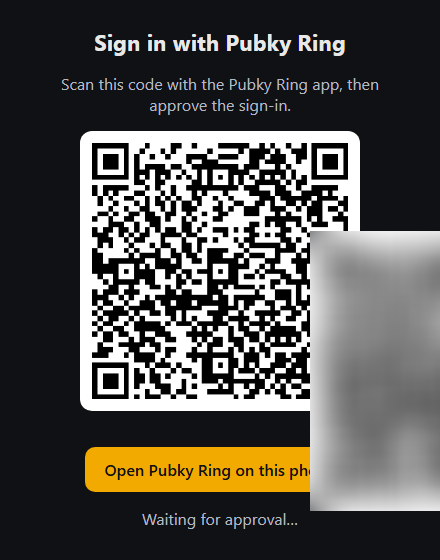

# pubky-oidc

**Sign in with Pubky Ring, anywhere OpenID Connect works.**

`pubky-oidc` is a small OpenID Connect provider whose only sign-in method is a [Pubky Ring](https://pubky.org) QR code. Put it in front of any app that supports "Sign in with OIDC" (a Matrix server, a forge, a dashboard…) and your users sign in with their Pubky identity: no password, no email, no sign-up form.

The `sub` claim it issues is the user's **Pubky public key**, so the relying party gets a stable user ID that the user owns.

<p align="center"></p>

## How it works

1. The relying party (your app) sends the user to this provider, as with any OIDC provider.
2. The provider shows a QR code (or, on a phone, an *Open Pubky Ring on this phone* button).
3. The user approves the request in Pubky Ring.
4. The provider receives the approval, finishes the OIDC flow and sends the user back to your app, signed in.

The Pubky Ring flow runs **entirely on the server**: the browser only displays the QR code and polls for the result. No homeserver cookie is ever set in the visitor's browser, so Safari's third-party cookie blocking is not a problem.

### Claims

| Claim | Scope | Value |
| --- | --- | --- |
| `sub` | `openid` | the Pubky public key (z-base-32) |
| `preferred_username` | `profile` | the same key |
| `name` | `profile` | the display name of the Pubky profile, read from [Nexus](https://nexus.pubky.app); falls back to `pubky abcd…wxyz` |

### Endpoints

Standard OIDC discovery at `<ISSUER>/.well-known/openid-configuration` (authorization, token, userinfo at `/me`, JWKS). Plus `/healthz` for health checks.

## Configuration

Environment variables (see [`.env.example`](.env.example)):

| Variable | Required | Default | Meaning |
| --- | --- | --- | --- |
| `ISSUER` | yes in production | `http://localhost:<PORT>` | Public URL of the provider, exactly as browsers and clients reach it |
| `CLIENT_SECRET` | yes | | Secret shared with the relying party |
| `REDIRECT_URIS` | yes | | Comma-separated redirect URIs allowed for the client |
| `CLIENT_ID` | no | `pubky-ring` | Client ID of the relying party |
| `PORT` | no | `4000` | HTTP port |
| `KEYS_FILE` | no | `./data/keys.json` | Signing keys, generated on first start. Keep this file: losing it invalidates every session |
| `NEXUS_URL` | no | `https://nexus.pubky.app` | Where display names are read |
| `PUBKY_RELAY` | no | the Pubky SDK default | HTTP relay used for the Pubky Ring handshake |
| `ALLOWED_HOMESERVERS` | no | any | Comma-separated homeserver public keys: only users whose Pubky record points to one of them may sign in |

The relying party authenticates with `client_secret_basic`, uses the authorization code flow, and asks for the `openid profile` scopes.

## Run it

### Locally

```sh
pnpm install
cp .env.example .env.local   # then set CLIENT_SECRET and REDIRECT_URIS
pnpm start
```

### With Docker

```sh
docker build -t pubky-oidc .
docker run -p 4000:4000 -v pubky-oidc-data:/data \
  -e ISSUER=https://auth.example.com \
  -e CLIENT_SECRET=... \
  -e REDIRECT_URIS=https://app.example.com/callback \
  pubky-oidc
```

Behind a TLS reverse proxy (Traefik, Caddy, nginx), the provider trusts the `X-Forwarded-*` headers. Mount `/data` on a volume so the signing keys survive restarts.

## Example: a Matrix server (Tuwunel)

[`examples/matrix-tuwunel`](examples/matrix-tuwunel) runs a local [Tuwunel](https://github.com/matrix-construct/tuwunel) homeserver whose only sign-in is Pubky Ring. The key setting is `userid_claims = ["sub"]`: the Pubky key becomes the Matrix localpart, so a user is `@<pubky-key>:<server_name>`.

```sh
# 1. the provider, with REDIRECT_URIS=http://localhost:8008/_matrix/client/unstable/login/sso/callback/pubky-ring
pnpm start
# 2. the same CLIENT_SECRET for Tuwunel
mkdir -p examples/matrix-tuwunel/secrets
printf '%s' "$CLIENT_SECRET" > examples/matrix-tuwunel/secrets/pubky_client_secret
docker compose -f examples/matrix-tuwunel/compose.yml up -d
```

Then point a Matrix client such as Element at `http://localhost:8008`.

This is how [matrix.pubky.pastalabs.dev](https://pastalabs.dev/blog/matrix-with-pubky-ring/) works.

## Tests, without a phone

A throwaway Pubky identity plays the part of Pubky Ring:

```sh
# the whole OIDC flow against a running provider
BASE=http://localhost:4000 REDIRECT_URI=<one of REDIRECT_URIS> pnpm test:e2e
# a full Matrix sign-in through Tuwunel (example above running)
MATRIX=http://localhost:8008 node examples/matrix-tuwunel/matrix-e2e.mjs
```

`matrix-e2e.mjs` also accepts `SEED=<64 hex>` to replay the same identity and check that a second sign-in lands on the same account.

## Limits

This is an early, working prototype, not an audited product.

- **One client.** The provider serves a single relying party (`CLIENT_ID`), and grants the requested scopes without a consent screen.
- **In-memory state.** Sign-ins in progress and OIDC sessions live in memory (oidc-provider's development adapter): a restart interrupts sign-ins in progress. Signing keys are persisted in `KEYS_FILE`; accounts live in the relying party, not here.
- **A QR code is valid for 10 minutes.** Reloading the page starts a fresh one.

## License

[MIT](LICENSE)
